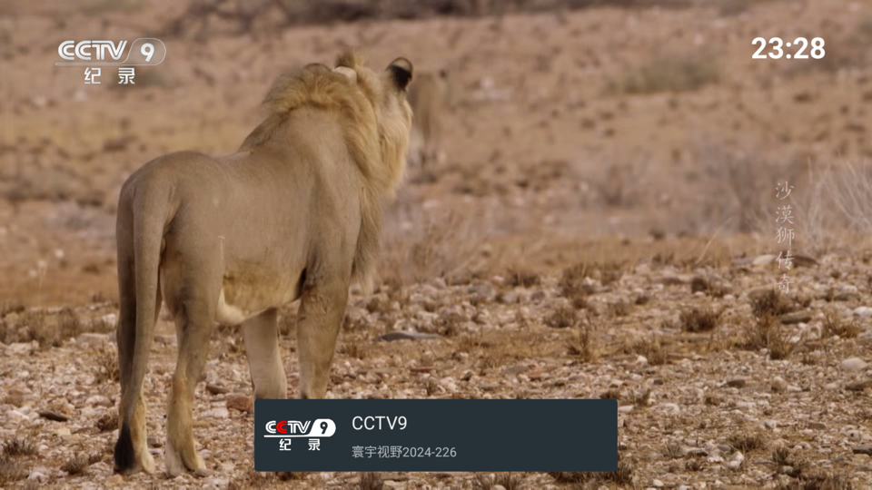

# 我的电视 · My TV

一个为电视盒子 / 智能电视打造的直播软件。**内置 318 个直播频道，安装即看**，无需注册、无需登录、无需配置。

> 频道源直连自建直播服务，不依赖任何第三方接口，启动即可播放。

---

## 功能特点

| 功能 | 说明 |
|---|---|
| 📺 内置频道 | 318 个频道，7 个分组，开箱即用 |
| ⚡ 秒开播放 | 直连 HLS 流，无需等待接口鉴权 |
| 🎮 遥控器优化 | 上下键换台、确认键切换、自动隐藏面板 |
| 🕐 时间显示 | 可开关的顶部时间显示，适合长期挂机 |
| 🔄 开机自启 | 电视开机自动进入直播 |
| 🎨 透明侧栏 | 频道面板半透明停靠左侧，不遮挡画面 |
| 📦 体积小巧 | 双架构（arm64-v8a / armeabi-v7a），兼容主流盒子 |

## 频道列表

| 分组 | 数量 |
|---|---|
| 央视 | 28 |
| 卫视 | 22 |
| 地方 | 36 |
| 其他 | 39 |
| 体育 · 昨天 | 109 |
| 体育 · 今天 | 47 |
| 体育 · 明天 | 37 |
| **合计** | **318** |

> 频道表在 `app/src/main/java/com/fanqichao/mytv/TVList.kt` 中维护，新增/删除频道只需编辑该文件。

---

## 下载安装

### 方式一：Release 安装包（推荐）

前往 [Releases](https://github.com/fanqichao/my-tv/releases/) 下载最新 `my-tv-*.apk`。

### 方式二：自行云编译（免签名，最快）

1. 打开仓库的 **Actions** 页面 → 左侧选择 `build-debug` → 点击 **Run workflow**
2. 等待约 10~20 分钟（首次需编译 native 库）
3. 进入该次运行页面，底部 **Artifacts** 下载 `my-tv-debug-apk`
4. 解压得到 APK

> `build-debug` 使用 debug 签名，可直接安装使用；若要正式签名包，见下方「签名发布」。

### 安装到电视

- **U 盘安装**：APK 拷到 U 盘，插入电视用文件管理器打开安装
- **电视助手**：小米电视可用「小米电视助手」推送安装
- **ADB 安装**（需电视开启开发者模式）：

  ```shell
  adb connect 电视IP:5555
  adb install my-tv.apk
  ```

## 截图




---

## 自定义直播源

频道数据集中在 `TVList.kt` 的 `setup()` 里，格式如下：

```kotlin
"分组名" to listOf(
    TV(
        0,                                        // id 由程序自动分配，填 0 即可
        "CCTV1综合",                               // 频道名称
        videoUrl = listOf("http://你的源/123456"),  // 播放地址（支持 m3u8 / 直连流）
        logo = "http://台标图片地址.png",            // 台标（可留空）
        programType = ProgramType.DIRECT,          // 直连播放，不走接口
    ),
    // ...更多频道
),
```

要点：

- `programType = ProgramType.DIRECT` 表示**直连播放**，程序不会去请求任何接口，直接用 `videoUrl` 播放
- `videoUrl` 支持 `http/https` 的 `m3u8`、`ts`、以及无后缀的直连流（会自动按 HLS 处理）
- 分组名就是界面上显示的分类名，增删分组只影响显示

改完后提交推送，云端会自动重新构建。

## 自行编译（本地）

环境要求：JDK 17、Android SDK（compileSdk 34）、NDK 25.1.8937393

```shell
# 调试包
./gradlew assembleDebug -PIS_SO_BUILD=false

# 正式包（需自行配置签名）
./gradlew assembleRelease -PIS_SO_BUILD=false
```

`-PIS_SO_BUILD=false` 表示使用仓库内预编译的 native 库（默认，速度快）；
若需要从源码编译 native 层，改为 `-PIS_SO_BUILD=true`。

### 签名发布

`build.yml` 用于打 tag（`v*`）时自动构建并发布 Release，需要先在仓库
**Settings → Secrets and variables → Actions** 配置 4 个密钥：

| Secret | 说明 |
|---|---|
| `KEYSTORE` | 签名文件（keystore）的 Base64 编码 |
| `KEYSTORE_PASSWORD` | keystore 密码 |
| `ALIAS` | 密钥别名 |
| `ALIAS_PASSWORD` | 别名密码 |

生成 Base64：

```shell
# macOS / Linux
base64 -i release.keystore | pbcopy     # macOS
base64 -w 0 release.keystore            # Linux
# Windows PowerShell
[Convert]::ToBase64String([IO.File]::ReadAllBytes("release.keystore")) | Set-Clipboard
```

## 常见问题

**Q：安装提示「解析包错误」或「应用未安装」**
A：确认电视系统为 Android 5.0（API 21）以上；若已装过其它签名的同包名版本，先卸载再装。

**Q：打开后黑屏 / 提示无法播放**
A：多为网络问题。先用手机浏览器访问频道地址确认源可用；部分盒子需要允许应用访问局域网。

**Q：频道列表是空的**
A：确认使用了 `ProgramType.DIRECT` 且 `videoUrl` 填写正确；`videoUrl` 为空或格式错误会被过滤。

**Q：换了新源后要重新装 APK 吗**
A：需要。频道表编译进 APK，改源必须重新构建安装。

---

## 免责声明

- 本项目仅供**学习与研究**使用，请勿用于任何商业用途，下载后请于 24 小时内删除。
- 本项目不存储、不制作、不转播任何音视频内容，所有播放地址均由使用者自行配置，相关责任由使用者承担。
- 本项目使用的部分代码、图片等资源来源于网络，如有侵权请联系删除。
- 直播源可用性受网络与服务端影响，本项目不对频道内容及可用性作任何保证。

## 支持

如果这个项目对你有帮助，欢迎 Star ⭐ 或请作者喝杯咖啡：


